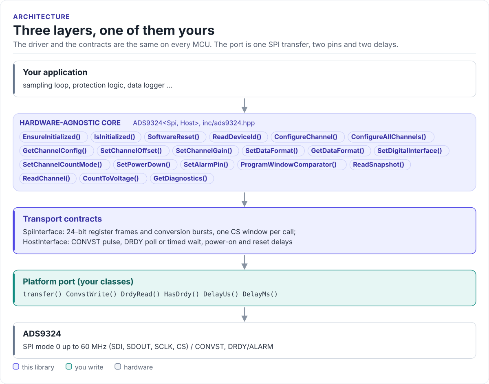
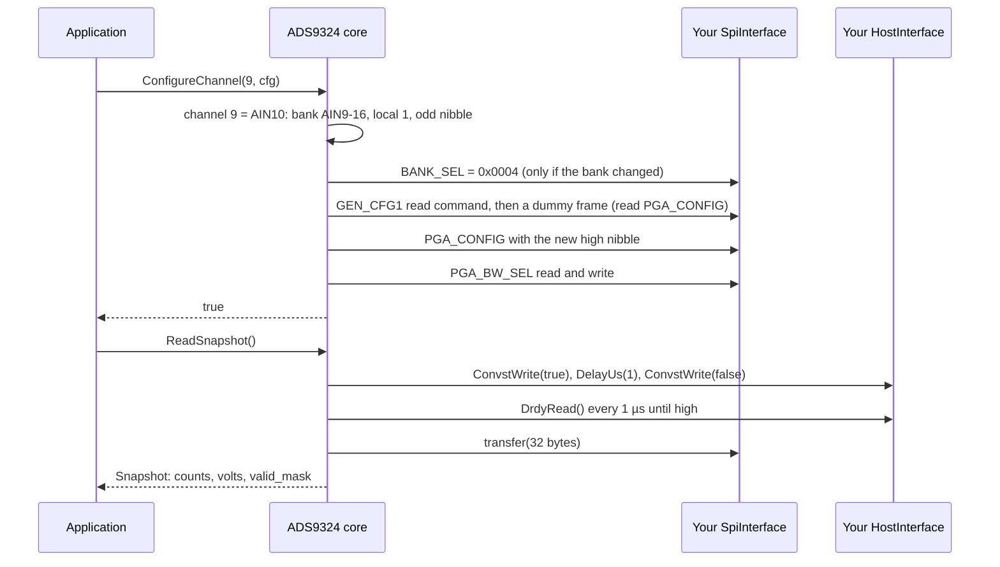

# Architecture

How the driver is put together: three layers, what each owns, and how one call reaches the chip.

<!-- figure: driver-layers -->
<picture>
  <source media="(prefers-color-scheme: dark)" srcset="diagrams/driver-layers.dark.svg">
  
</picture>
<!-- /figure -->

## The three layers

| Layer | Where | You change it |
| --- | --- | --- |
| **Core**: `ADS9324<Spi, Host>`, uses the two contracts only | [`ads9324.hpp`](../inc/ads9324.hpp), [`ads9324.ipp`](../src/ads9324.ipp) | Never, for a new board |
| **Contracts**: `SpiInterface`, `HostInterface`, six methods of your port | [`ads9324_spi_interface.hpp`](../inc/ads9324_spi_interface.hpp) | Never |
| **Platform port**: your classes, over your SDK | Your project | Once per MCU or board ([Porting](porting.md)) |

Everything above the port is the same on ESP32, STM32, a Linux host or the unit-test mock. That is how the
[host tests](testing.md) run the real driver code without hardware.

## How one call reaches the chip

## Why CRTP

The contracts are class template parameters, not virtual base classes. The compiler sees your port's methods
directly and inlines them; the driver has no vtable, allocates nothing and needs no RTTI. The cost is that the
driver type names the port: `ADS9324<MySpi, MyHost>`. One class can implement both contracts and be passed twice,
as the ESP32 examples do.

## What the driver keeps in RAM

The object caches the selected register bank (so a burst of writes to one bank costs one BANK_SEL frame), each
channel's last `ChannelConfig` (for `CountToVoltage()`), the data format, lane and word-length settings, the
channel-count mode and two counters. It reads nothing back from the chip except DEVICE_ID and the shared PGA,
bandwidth and comparator registers it read-modify-writes.

## Source map

| Path | Contents |
| --- | --- |
| `inc/ads9324.hpp` | `ADS9324<Spi, Host>`: the public API |
| `src/ads9324.ipp` | Template implementation, included by the header |
| `inc/ads9324_spi_interface.hpp` | `SpiInterface` and `HostInterface` |
| `inc/ads9324_types.hpp` | Enums, `ChannelConfig`, `Snapshot`, `ReadResult`, `Diagnostics`, conversion helpers |
| `inc/ads9324_registers.hpp` | Register addresses, bank values, frame packing (`ads9324::reg`) |
| `inc/ads9324_config.hpp` | Compile-time defaults (`ADS9324_CFG`) |
| `tests/` | Host tests and the compiled documentation snippets |
| `examples/esp32/` | ESP-IDF applications |
