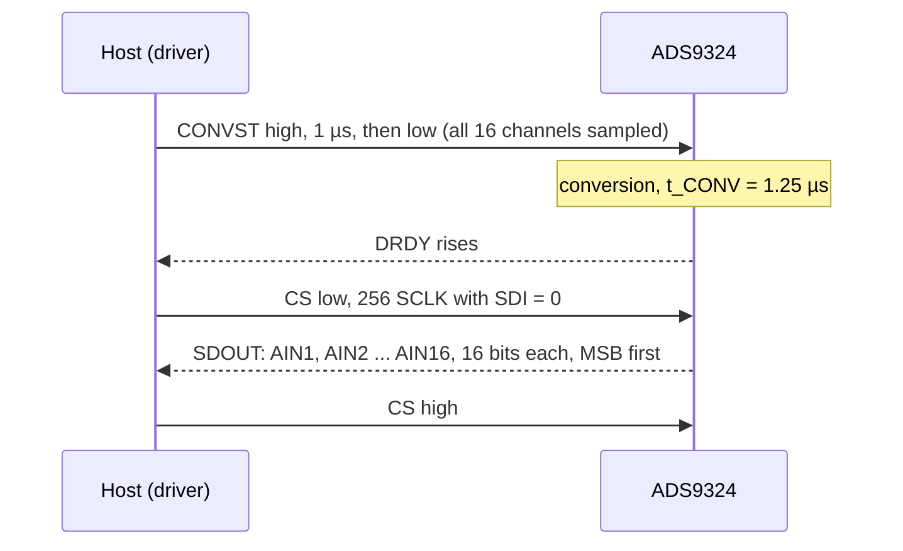

# Hardware

What to connect between your MCU and an ADS9324, with which bus settings, and the board-level details that decide
whether the first read works.

All values here come from the [ADS9324 datasheet](datasheet/ads9324.pdf) (SBASB22, December 2025). When they
disagree with a board's schematic, the schematic wins for pin numbers; the datasheet wins for limits.

## Host interface pins

The driver uses the register SPI port for everything: register frames on SDI, register read-back and conversion
data on SDOUT. The eight parallel data lanes stay unused.

| Signal (pin), direction | Notes |
| --- | --- |
| SCLK (37), in | SPI clock; idles low |
| SDI (36), in | Latched on the SCLK rising edge |
| SDOUT (38), out | Register data and 1-lane conversion data; Hi-Z while CS is high |
| CS (35), in | Active low; a register write is decoded on the CS rising edge |
| D0 to D7 (46 to 39), out | Parallel data lanes, not used by the driver |

## Control pins

| Pin (number) | What it does | Driver use |
| --- | --- | --- |
| CONVST (50), in | The falling edge samples all channels | `ConvstWrite()`: high for 1 µs, then low |
| DRDY/ALARM (49), out | Data ready, active high by default; can carry the window-comparator alert instead | `DrdyRead()`, polled every 1 µs up to `DRDY_TIMEOUT_US` |
| RESET (32), in | Active-low asynchronous reset | Not driven: tie it high (to IOVDD) or give it its own GPIO |
| REFSEL (31), in | High: internal 4.096 V reference. Low: external reference on REFIO | Not driven: tie it high for the internal reference |

The driver resets the chip with the SW_RST bit in GEN_CFG1, so the RESET pin can stay high. If you leave REFSEL low
without an external reference on REFIO, the chip powers down (SBASB22 section 7.3.6).

## Bus settings

| Setting | Value |
| --- | --- |
| Mode | SPI mode 0 (CPOL = 0, CPHA = 0), MSB first: SDI is latched on the rising edge, SCLK ends low before CS rises |
| Clock | Up to 60 MHz (fSCLK); the ESP32-C6 examples use 8 MHz |
| Register frame | 24 bits: 8-bit address, 16-bit data; CS low for the whole frame |
| Conversion read | One CS-low burst: 16 bits per channel, 32 bytes for 16 channels (48 bytes with 24-bit words) |
| Chip select | High at least 16 ns between frames; 16 ns setup to the first edge and hold after the last |
| I/O levels | VIH ≥ 0.7 × IOVDD, VIL ≤ 0.3 × IOVDD |

The mode follows from the timing requirements (SDI captured on the rising edge, CS hold measured from the last
falling edge); the datasheet does not name an SPI mode.

### Throughput in 1-lane mode

Sixteen 16-bit words on one lane take 256 SCLK cycles. At the 60 MHz maximum that is 4.3 µs per snapshot, so
1-lane mode cannot exceed about 230 kSPS per channel, not the chip's 1 MSPS; at 8 MHz it is 32 µs, under 31 kSPS.
These figures count clock cycles only; the conversion time, CS gaps and software overhead lower them further. Fewer channels
([`SetChannelCountMode()`](api-guide.md#read-fewer-channels)) or the parallel lanes raise the rate; the driver
supports only 1-lane capture.

## One snapshot on the wire

## Timing

| Parameter | Value | Where the driver handles it |
| --- | --- | --- |
| Power-up time tPU (1 µF on REFCAP) | 30 ms | `EnsureInitialized()` waits `POWER_ON_DELAY_MS` = 30 |
| Wait after software reset | 1 ms (optional, Table 7-18) | `RESET_DELAY_MS` = 1 |
| CONVST high and low time | at least 50 ns each | The driver holds CONVST high for 1 µs |
| Conversion time tCONV, no oversampling | 1.25 µs | DRDY poll, or `CONV_FALLBACK_US` = 10 µs without DRDY |
| CONVST rate fCONVST | 0.1 MHz to 1 MHz | See the note below |

!!! note "Sampling rate and the specifications"
    The datasheet specifies the ADC for a CONVST rate of 100 kHz to 1 MHz. `ReadSnapshot()` issues one CONVST
    per call, so a slow polling loop runs the chip below that range. The conversions still complete; the
    datasheet's dynamic performance figures are not guaranteed there.

## Power

| Supply (pins) | Range | Current at full rate, typ / max |
| --- | --- | --- |
| AVDD_5V (26, 27, 56) | 4.75 V to 5.25 V | 30 mA / 35 mA |
| AVDD_1V8 (30, 51) | 1.7 V to 1.9 V | 32 mA / 38 mA |
| IOVDD (34, 47) | 1.7 V to 3.6 V | 6 mA / 10 mA |

Total dissipation is 230 mW typical, 295 mW maximum, at full throughput; standby (`SetPowerDown(true)`) is about
6.5 mW. There is no power-up sequence requirement. Decouple each supply pin with 1 µF and 0.1 µF to GND. Match
IOVDD to your MCU's I/O voltage.

The reference needs 4.7 µF from REFIO to REFM (pin 53) and 1 µF X7R between REFCAPA and REFM (pins 52 and 53) and
between REFCAPB and REFM (pins 29 and 28). Connect REFM, GND and the thermal pad to the ground plane.

## Analog inputs

| Limit | Value |
| --- | --- |
| Input impedance | 1 MΩ typical (0.8 MΩ to 1.2 MΩ) on each of AIN*n*P and AIN*n*M |
| Full-scale ranges (AIN*n*P − AIN*n*M) | ±2.5, ±5, ±6.25, ±10, ±12.5 V |
| Common-mode range, differential | ±12.5 V |
| Operating input voltage, differential | –17 V to +17 V on each pin |
| Operating input voltage, single-ended | AIN*n*P –13 V to +13 V, AIN*n*M –0.5 V to +0.5 V |
| Absolute maximum, AIN*n*P and AIN*n*M | ±18 V; 10 mA per pin |
| Low-pass filter (–3 dB) | 25.5 kHz (low bandwidth) or 280 kHz to 350 kHz (wide, by range) |

Match the source resistance on AIN*n*P with the same resistance on AIN*n*M to cancel the offset it adds.

## Evaluation and example wiring

The [ESP32 examples](examples.md) target an ESP32-C6 DevKit; the pins are in
[`esp32_ads9324_test_config.hpp`](../examples/esp32/main/esp32_ads9324_test_config.hpp):

| Function | ADS9324 | ESP32-C6 GPIO |
| --- | --- | --- |
| SPI MISO | SDOUT | 5 |
| SPI MOSI | SDI | 6 |
| SPI SCLK | SCLK | 4 |
| SPI CS | CS | 10 |
| CONVST | CONVST | 3 |
| DRDY | DRDY/ALARM | 11 |

## Reference documents

| Document | What it is for |
| --- | --- |
| [ADS9324 datasheet (SBASB22)](datasheet/ads9324.pdf) | Pins, electrical limits, timing, register maps |
| [ADS9324 product page](https://www.ti.com/product/ADS9324) | Latest datasheet revision, evaluation module, errata |
